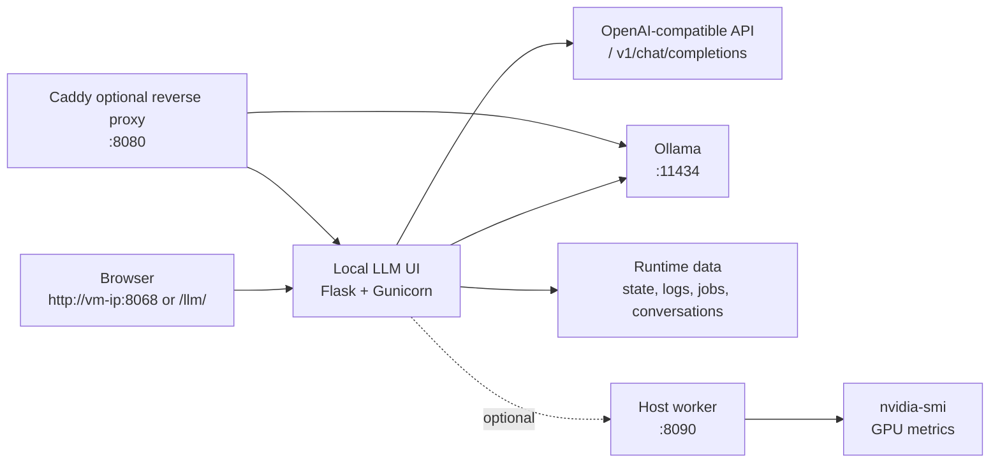
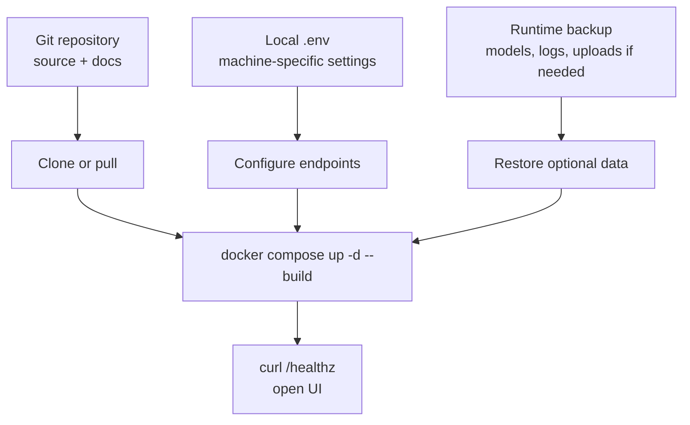

# Local LLM VM Console

A standalone local LLM stack for running an Ollama model, a browser-based UI, and an optional host worker from a VM on Windows or Linux.

This repository is public-safe by design. It contains source code, setup scripts, documentation, examples, and diagrams. It does not contain private project names, credentials, runtime data, model weights, logs, uploaded datasets, or generated job output.

## Quick Start

Clone and start the Docker stack:

```bash
git clone https://github.com/YOUR-USER/local-llm-vm-console.git
cd local-llm-vm-console
cp .env.example .env
docker compose up -d --build
```

Open:

```text
http://localhost:8068
```

Pull a starter model:

```bash
docker compose exec ollama ollama pull llama3.2:3b
```

Smoke test:

```bash
curl -fsS http://localhost:8068/healthz
curl -fsS http://localhost:11434/api/version
```

## What This Includes

| Area | Path | Purpose |
| --- | --- | --- |
| Web UI | `app/` | Flask UI for chat, model inventory, runtime settings, logs, and host resource monitoring. |
| Host worker | `worker/host_worker.py` | Optional Windows or Linux host-side GPU status API using `nvidia-smi`. |
| Docker stack | `compose.yml`, `Dockerfile` | Runs the UI, Ollama, and optional Caddy reverse proxy. |
| Windows helpers | `deploy/windows/` | PowerShell scripts for starting the host worker and installing it as a logon task. |
| Linux helpers | `deploy/linux/` | Caddy route file and systemd service for VM autostart. |
| Examples | `examples/` | Starter model file and sample JSONL chat data. |
| Documentation | `docs/`, `references/` | Setup guides, operations notes, security policy, and reference links. |

## Architecture



## Deployment Patterns

### 1. Linux VM, CPU or Linux GPU

Use this when the VM can run Docker and either does not need GPU acceleration or has GPU passthrough configured.

```bash
cp .env.example .env
docker compose up -d --build
docker compose exec ollama ollama pull llama3.2:3b
```

For Linux GPU acceleration, install the NVIDIA driver and NVIDIA Container Toolkit, then enable `gpus: all` in `compose.yml`.

### 2. Linux VM on a Windows Host

Use this when the Windows host has the NVIDIA GPU and the VM runs the UI.

1. Run Ollama on the Windows host, or expose it from Docker Desktop.
2. Start the host worker on Windows:

   ```powershell
   .\deploy\windows\start-host-worker.ps1
   ```

3. Set `.env` inside the VM to point at the host IP reachable from the VM:

   ```env
   OLLAMA_BASE_URL=http://192.168.56.1:11434
   OPENAI_BASE_URL=http://192.168.56.1:11434/v1
   HOST_WORKER_STATUS_URL=http://192.168.56.1:8090/gpu/status
   ```

4. Start the UI:

   ```bash
   docker compose up -d --build llm-ui caddy
   ```

### 3. All-in-One Windows Workstation

Use this when Docker Desktop and Ollama both run on Windows.

```powershell
copy .env.example .env
docker compose up -d --build
ollama pull llama3.2:3b
.\deploy\windows\start-host-worker.ps1
```

Open `http://localhost:8068`.

## UI Features

- Chat playground using any OpenAI-compatible endpoint.
- Ollama model inventory and model pull button.
- Editable safe runtime settings.
- Sampling profiles for fast, balanced, coding, and creative modes.
- CPU, RAM, disk, process, and optional GPU metrics.
- Log viewer.
- JSON health endpoints for external monitors.

## API Surface

| Endpoint | Method | Purpose |
| --- | --- | --- |
| `/healthz` | `GET` | UI health, model reachability, and version. |
| `/version` | `GET` | Version metadata. |
| `/api/status` | `GET` | Combined config, models, metrics, jobs, and datasets. |
| `/api/models` | `GET` | Model list from Ollama and OpenAI-compatible API. |
| `/api/models/pull` | `POST` | Pull an Ollama model. |
| `/api/chat` | `POST` | Chat completion proxy. |
| `/api/metrics` | `GET` | Host/VM process and resource metrics. |
| `/api/config` | `GET`, `POST` | Read/update safe runtime settings. |
| `/api/logs` | `GET` | List log files. |
| `/api/logs/<name>` | `GET` | Tail a log file. |

Chat example:

```bash
curl -fsS http://localhost:8068/api/chat \
  -H "Content-Type: application/json" \
  -d '{"messages":[{"role":"user","content":"Reply with Local LLM OK"}],"stream":false}'
```

## Model Examples

Create a local custom model:

```bash
ollama pull llama3.2:3b
ollama create local-assistant -f examples/modelfiles/Modelfile.example
```

Then set `LLM_UI_DEFAULT_MODEL=local-assistant` in `.env`, or edit the default model in the Settings tab.

## Storage Policy

Git stores:

- Source code
- Docker files
- Deployment scripts
- Documentation
- Example templates
- Test fixtures that are intentionally small and public

Git does not store:

- Model weights
- Runtime state
- Conversations
- Logs
- Uploaded datasets
- Job output
- Secrets or environment files

Runtime data is intentionally ignored under `runtime/`, `data/`, `logs/`, `jobs/`, and related folders.

## Backup and Restore



Recommended restore order:

1. Clone or pull this Git repository.
2. Recreate `.env` from `.env.example`.
3. Start Docker services.
4. Pull or restore models.
5. Restore runtime data only if needed.
6. Verify `/healthz`, Ollama `/api/version`, and the UI.

## Documentation Map

- [Installation Guide](docs/installation.md)
- [Configuration Reference](docs/configuration.md)
- [Operations Guide](docs/operations.md)
- [Model Guide](docs/model-guide.md)
- [Security and Public Repo Policy](docs/security.md)
- [External References](references/README.md)

## Public Repo Checklist

- No private organization, customer, project, or user names.
- No credentials, passwords, keys, or tokens.
- No runtime data or model artifacts.
- `.env.example` documents variable names only.
- README is the single starting point.
- Diagrams live in README and `docs/graphics/`.

## License

This project is released under the MIT License. See [LICENSE](LICENSE).
