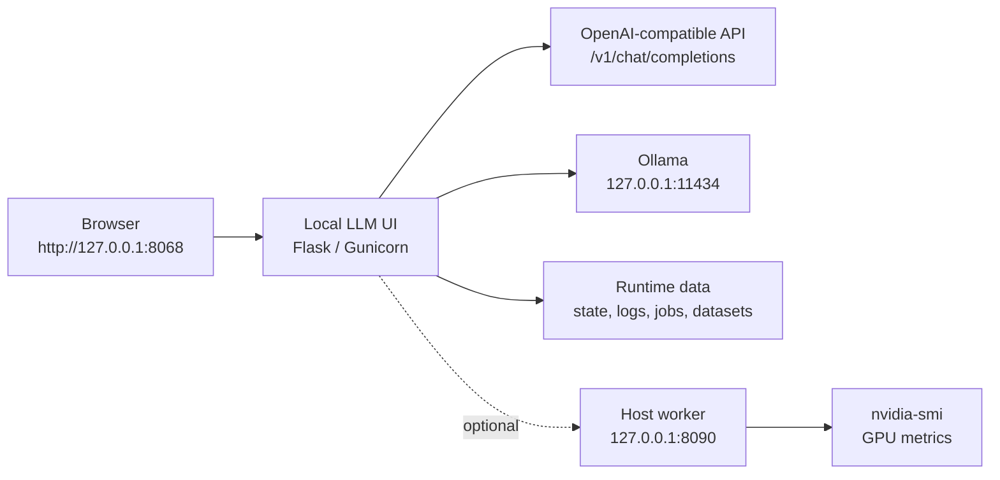
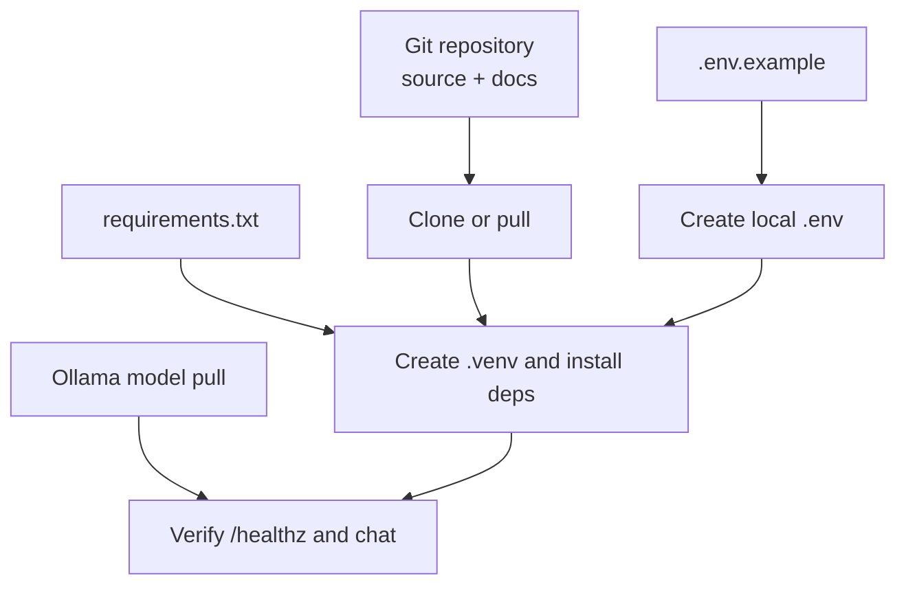

# Local LLM Console

A standalone local LLM package for running an Ollama-backed browser UI and an optional host worker on Windows or Linux. The package is designed to clone the working native setup: source is managed by Git, runtime data stays local, and the application runs from a project `.venv`.

This repository is public-safe by design. It contains source code, setup scripts, documentation, examples, and diagrams. It does not contain private project names, credentials, runtime data, model weights, logs, uploaded datasets, or generated job output.

## Quick Start

Windows:

```powershell
git clone https://github.com/gmode2020x-tim/local-llm-vm-console.git
cd local-llm-vm-console
.\deploy\windows\setup-native.ps1
ollama pull llama3.2:3b
.\deploy\windows\start-ui.ps1
.\deploy\windows\start-host-worker.ps1
```

Linux:

```bash
git clone https://github.com/gmode2020x-tim/local-llm-vm-console.git
cd local-llm-vm-console
chmod +x deploy/linux/setup-native.sh
./deploy/linux/setup-native.sh
ollama pull llama3.2:3b
set -a
source .env
set +a
.venv/bin/gunicorn -w 2 -b 0.0.0.0:${PORT:-8068} app.app:app
```

Open:

```text
http://127.0.0.1:8068
```

Smoke test:

```bash
curl -fsS http://127.0.0.1:8068/healthz
curl -fsS http://127.0.0.1:11434/api/version
```

## What This Includes

| Area | Path | Purpose |
| --- | --- | --- |
| Web UI | `app/` | Flask UI for chat, model inventory, runtime settings, logs, and host resource monitoring. |
| Host worker | `worker/host_worker.py` | Optional host-side GPU status API using `nvidia-smi`. |
| Windows helpers | `deploy/windows/` | PowerShell scripts for native setup, UI start, host worker start, and logon tasks. |
| Linux helpers | `deploy/linux/` | Native setup script and systemd service for autostart. |
| Examples | `examples/` | Starter model file and sample JSONL chat data. |
| Documentation | `docs/`, `references/` | Setup guides, operations notes, security policy, and reference links. |

## Architecture



## Deployment Patterns

### 1. All-In-One Workstation

Use this when the UI, Ollama, and optional GPU telemetry worker all run on the same Windows or Linux machine.

```env
OLLAMA_BASE_URL=http://127.0.0.1:11434
OPENAI_BASE_URL=http://127.0.0.1:11434/v1
HOST_WORKER_STATUS_URL=http://127.0.0.1:8090/gpu/status
```

### 2. Linux VM With Host Ollama

Use this when a Linux VM runs the UI and another private host runs Ollama or the GPU worker.

```env
OLLAMA_BASE_URL=http://<host-ip>:11434
OPENAI_BASE_URL=http://<host-ip>:11434/v1
HOST_WORKER_STATUS_URL=http://<host-ip>:8090/gpu/status
```

Keep these services on a trusted private network.

## Autostart

Windows UI:

```powershell
.\deploy\windows\install-ui-task.ps1
```

Windows host worker:

```powershell
.\deploy\windows\install-host-worker-task.ps1
```

Linux systemd:

```bash
sudo APP_DIR=/opt/local-llm-vm-console ./deploy/linux/install-systemd.sh
```

## UI Features

- Chat playground using any OpenAI-compatible endpoint.
- Ollama model inventory and model pull button.
- Editable safe runtime settings.
- Sampling profiles for fast, balanced, coding, and creative modes.
- CPU, RAM, disk, process, and optional GPU metrics.
- Log viewer.
- JSON health endpoints for external monitors.

## API Surface

| Endpoint | Method | Purpose |
| --- | --- | --- |
| `/healthz` | `GET` | UI health, model reachability, and version. |
| `/version` | `GET` | Version metadata. |
| `/api/status` | `GET` | Combined config, models, metrics, jobs, and datasets. |
| `/api/models` | `GET` | Model list from Ollama and OpenAI-compatible API. |
| `/api/models/pull` | `POST` | Pull an Ollama model. |
| `/api/chat` | `POST` | Chat completion proxy. |
| `/api/metrics` | `GET` | Host process and resource metrics. |
| `/api/config` | `GET`, `POST` | Read/update safe runtime settings. |
| `/api/logs` | `GET` | List log files. |
| `/api/logs/<name>` | `GET` | Tail a log file. |

Chat example:

```bash
curl -fsS http://127.0.0.1:8068/api/chat \
  -H "Content-Type: application/json" \
  -d '{"messages":[{"role":"user","content":"Reply with Local LLM OK"}],"stream":false}'
```

## Model Examples

Create a local custom model:

```bash
ollama pull llama3.2:3b
ollama create local-assistant -f examples/modelfiles/Modelfile.example
```

Then set `LLM_UI_DEFAULT_MODEL=local-assistant` in `.env`, or edit the default model in the Settings tab.

## Storage Policy

Git stores:

- Source code
- Deployment scripts
- Documentation
- Example templates
- Small public test fixtures

Git does not store:

- Model weights
- Runtime state
- Conversations
- Logs
- Uploaded datasets
- Job output
- Secrets or environment files

Runtime data is intentionally ignored under `runtime/`, `data/`, `logs/`, `jobs/`, and related folders.

## Backup and Restore



Recommended restore order:

1. Clone or pull this Git repository.
2. Recreate `.env` from `.env.example`.
3. Create `.venv` and install `requirements.txt`.
4. Pull or restore Ollama models.
5. Restore runtime data only if needed.
6. Verify `/healthz`, Ollama `/api/version`, and the UI.

## Documentation Map

- [Installation Guide](docs/installation.md)
- [Configuration Reference](docs/configuration.md)
- [Operations Guide](docs/operations.md)
- [Model Guide](docs/model-guide.md)
- [Security and Public Repo Policy](docs/security.md)
- [External References](references/README.md)

## Public Repo Checklist

- No private organization, customer, project, or user names.
- No credentials, passwords, keys, or tokens.
- No runtime data or model artifacts.
- `.env.example` documents variable names only.
- README is the single starting point.
- Diagrams live in README and `docs/graphics/`.

## License

This project is released under the MIT License. See [LICENSE](LICENSE).
